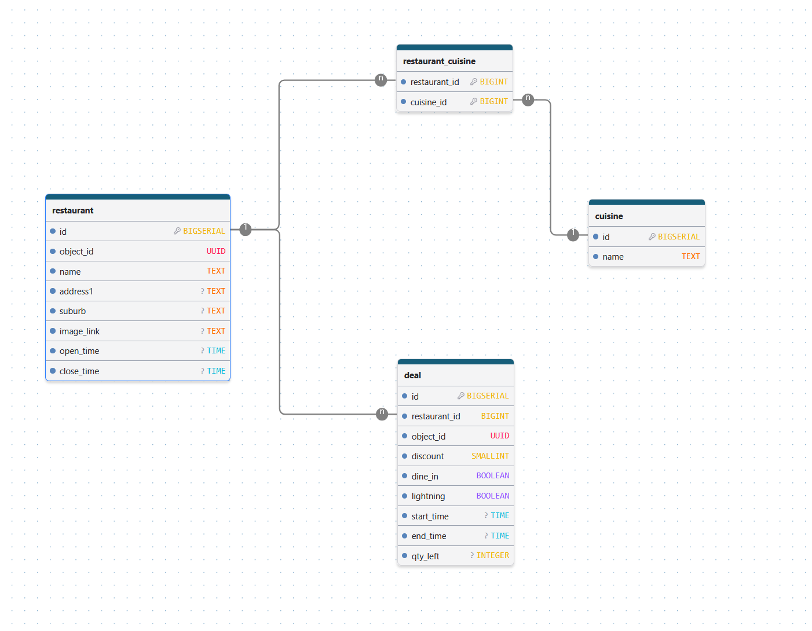

# restaurant-deals-api
I've created a Java Spring Boot API using Java 21, Maven 3.9.11 and Spring Boot 4.1.2.

To run it use this command:

`./mvnw spring-boot:run`

## Task 1: Restaurant Deals API
This endpoint takes in a time of day string, in 12h or 24h formats, as a parameter. It then retrieves the challenge data from the provided API and uses the time parameter to find all the active restaurant deals in the data.

- Restaurants with no time entries are considered to be open 24 hours.
- A deal with no times follows its restaurant's hours.
- Overnight times are considered, a closing time earlier in the day than an opening time is treated as running past midnight.
- End times are exclusive and start times are inclusive.
- A deal is only active when the restaurant is open.
- Deals that have 0 quantity are considered sold out and inactive.
- Deals that have a null value in qtyLeft are treated as unlimited.
- restarantSuburb is misspelled to match the contract outlined in the challenge pdf.
- I've handled the inconsistent start/end open/close keys in the reference data. On the job I'd raise this as a bug and other factors would decide whether I take the technical debt forward.

The full results for 3:00pm, 6:00pm and 9:00pm are in [Task 1 Results](#task-1-results) at the bottom of the file.

### Request
`http://localhost:8080/v1/deals?timeOfDay=3:00pm`
or
`http://localhost:8080/v1/deals?timeOfDay=15:00`

### Response
```json
{
    "deals": [
        {
            "restaurantObjectId": "DEA567C5-F64C-3C03-FF00-E3B24909BE00",
            "restaurantName": "Masala Kitchen",
            "restaurantAddress1": "55 Walsh Street",
            "restarantSuburb": "Lower East",
            "restaurantOpen": "3:00pm",
            "restaurantClose": "9:00pm",
            "dealObjectId": "DEA567C5-0000-3C03-FF00-E3B24909BE00",
            "discount": "50",
            "dineIn": "false",
            "lightning": "true",
            "qtyLeft": "5"
        },
        {
            "restaurantObjectId": "DEA567C5-F64C-3C03-FF00-E3B24909BE00",
            "restaurantName": "Masala Kitchen",
            "restaurantAddress1": "55 Walsh Street",
            "restarantSuburb": "Lower East",
            "restaurantOpen": "3:00pm",
            "restaurantClose": "9:00pm",
            "dealObjectId": "DEA567C5-1111-3C03-FF00-E3B24909BE00",
            "discount": "40",
            "dineIn": "true",
            "lightning": "false",
            "qtyLeft": "4"
        },
        {
            "restaurantObjectId": "D80263E8-FD89-2C70-FF6B-D854ADB8DB00",
            "restaurantName": "ABC Chicken",
            "restaurantAddress1": "361 Queen Street",
            "restarantSuburb": "Melbourne",
            "restaurantOpen": "12:00pm",
            "restaurantClose": "11:00pm",
            "dealObjectId": "D80263E8-0000-2C70-FF6B-D854ADB8DB00",
            "discount": "30",
            "dineIn": "false",
            "lightning": "false",
            "qtyLeft": "1"
        },
        {
            "restaurantObjectId": "D80263E8-FD89-2C70-FF6B-D854ADB8DB00",
            "restaurantName": "ABC Chicken",
            "restaurantAddress1": "361 Queen Street",
            "restarantSuburb": "Melbourne",
            "restaurantOpen": "12:00pm",
            "restaurantClose": "11:00pm",
            "dealObjectId": "D80263E8-1111-2C70-FF6B-D854ADB8DB00",
            "discount": "20",
            "dineIn": "true",
            "lightning": "false",
            "qtyLeft": "4"
        },
        {
            "restaurantObjectId": "B5713CD0-91BF-40C7-AFC3-7D46D26B00BF",
            "restaurantName": "Kekou",
            "restaurantAddress1": "396 Bridge Road",
            "restarantSuburb": "Richmond",
            "restaurantOpen": "1:00pm",
            "restaurantClose": "11:00pm",
            "dealObjectId": "B5713CD0-0000-40C7-AFC3-7D46D26B00BF",
            "discount": "10",
            "dineIn": "true",
            "lightning": "true",
            "qtyLeft": "3"
        }
    ]
}
```
## Task 2: Peak Time API
This endpoint finds the time period when the most deals are active. It uses a line sweep algorithm to do this.
The number of active deals can only change when a restaurant opens or closes, or when a deal starts or ends. Those are stored as boundaries and the active deals are counted at each one. 

The returned time period starts at the first boundary where the most deals are active and ends at the next boundary where the number of active deals drops.
### Request
`http://localhost:8080/v1/peak-time`

### Response
```json
{
  "peakTimeStart": "6:00pm",
  "peakTimeEnd": "9:00pm"
}
```
## Task 3: Database schema for restaurant and deals data

I've decided on SQL for the database over NoSQL based on a few assumptions:

- I'm assuming the way my API is processing this data is indicative of how the restaurant data would be queried in the database. Both endpoints query all restaurants and their deals based on time.
- Given that this data is being exposed through an API we generally want a strict schema that's enforced by the database. This isn't always the case but the stored data should follow the strictness of an API contract.
- The data follows a consistent relationship pattern and naturally fits SQL.

I've decided on PostgreSQL as it's open-source, available on AWS and industry standard.

The database has a table for restaurants and its own generated primary key, id. Despite the restaurant object ids being unique, I decided against using object_id because it's duplicated in the deals data (B5713CD0-1111-40C7-AFC3-7D46D26B00BF), and I'm not sure how it's generated and used outside of this API.

The deals table stores the restaurant table's primary key as a foreign key and maintains its own generated primary key as a restaurant can have many deals. I've also added a composite unique constraint to keep deals for a restaurant unique and to index the search for a restaurant's deals.

To avoid duplicating cuisines for each restaurant I've created a cuisine table which stores a cuisine with its own unique id.

I've also created a junction table, restaurant_cuisine which uses a foreign key from restaurant and cuisine and links them in a many-to-many relationship, while still keeping cuisine entries unique.

**Database Diagram:**



SQL Commands:

```sql
CREATE TABLE IF NOT EXISTS "restaurant" (
"id" BIGSERIAL,
"object_id" UUID NOT NULL UNIQUE,
"name" TEXT NOT NULL,
"address1" TEXT,
"suburb" TEXT,
"image_link" TEXT,
"open_time" TIME,
"close_time" TIME,
PRIMARY KEY("id")
);

CREATE TABLE IF NOT EXISTS "deal" (
"id" BIGSERIAL,
"restaurant_id" BIGINT NOT NULL,
"object_id" UUID NOT NULL,
"discount" SMALLINT NOT NULL,
"dine_in" BOOLEAN NOT NULL,
"lightning" BOOLEAN NOT NULL,
"start_time" TIME,
"end_time" TIME,
"qty_left" INTEGER,
PRIMARY KEY("id"),
CONSTRAINT "deal_unique_0" UNIQUE ("restaurant_id", "object_id")
);

CREATE TABLE IF NOT EXISTS "cuisine" (
"id" BIGSERIAL,
"name" TEXT NOT NULL UNIQUE,
PRIMARY KEY("id")
);

CREATE TABLE IF NOT EXISTS "restaurant_cuisine" (
"restaurant_id" BIGINT NOT NULL,
"cuisine_id" BIGINT NOT NULL,
PRIMARY KEY("restaurant_id", "cuisine_id")
);

ALTER TABLE "deal"
ADD FOREIGN KEY("restaurant_id") REFERENCES "restaurant"("id")
ON UPDATE NO ACTION ON DELETE NO ACTION;

ALTER TABLE "restaurant_cuisine"
ADD FOREIGN KEY("restaurant_id") REFERENCES "restaurant"("id")
ON UPDATE NO ACTION ON DELETE NO ACTION;

ALTER TABLE "restaurant_cuisine"
ADD FOREIGN KEY("cuisine_id") REFERENCES "cuisine"("id")
ON UPDATE NO ACTION ON DELETE NO ACTION;
```

## Task 1 Results

### 3PM results
#### Request
`http://localhost:8080/v1/deals?timeOfDay=3:00pm`
or
`http://localhost:8080/v1/deals?timeOfDay=15:00`

#### Response
```json 
{
  "deals": [
    {
      "restaurantObjectId": "DEA567C5-F64C-3C03-FF00-E3B24909BE00",
      "restaurantName": "Masala Kitchen",
      "restaurantAddress1": "55 Walsh Street",
      "restarantSuburb": "Lower East",
      "restaurantOpen": "3:00pm",
      "restaurantClose": "9:00pm",
      "dealObjectId": "DEA567C5-0000-3C03-FF00-E3B24909BE00",
      "discount": "50",
      "dineIn": "false",
      "lightning": "true",
      "qtyLeft": "5"
    },
    {
      "restaurantObjectId": "DEA567C5-F64C-3C03-FF00-E3B24909BE00",
      "restaurantName": "Masala Kitchen",
      "restaurantAddress1": "55 Walsh Street",
      "restarantSuburb": "Lower East",
      "restaurantOpen": "3:00pm",
      "restaurantClose": "9:00pm",
      "dealObjectId": "DEA567C5-1111-3C03-FF00-E3B24909BE00",
      "discount": "40",
      "dineIn": "true",
      "lightning": "false",
      "qtyLeft": "4"
    },
    {
      "restaurantObjectId": "D80263E8-FD89-2C70-FF6B-D854ADB8DB00",
      "restaurantName": "ABC Chicken",
      "restaurantAddress1": "361 Queen Street",
      "restarantSuburb": "Melbourne",
      "restaurantOpen": "12:00pm",
      "restaurantClose": "11:00pm",
      "dealObjectId": "D80263E8-0000-2C70-FF6B-D854ADB8DB00",
      "discount": "30",
      "dineIn": "false",
      "lightning": "false",
      "qtyLeft": "1"
    },
    {
      "restaurantObjectId": "D80263E8-FD89-2C70-FF6B-D854ADB8DB00",
      "restaurantName": "ABC Chicken",
      "restaurantAddress1": "361 Queen Street",
      "restarantSuburb": "Melbourne",
      "restaurantOpen": "12:00pm",
      "restaurantClose": "11:00pm",
      "dealObjectId": "D80263E8-1111-2C70-FF6B-D854ADB8DB00",
      "discount": "20",
      "dineIn": "true",
      "lightning": "false",
      "qtyLeft": "4"
    },
    {
      "restaurantObjectId": "B5713CD0-91BF-40C7-AFC3-7D46D26B00BF",
      "restaurantName": "Kekou",
      "restaurantAddress1": "396 Bridge Road",
      "restarantSuburb": "Richmond",
      "restaurantOpen": "1:00pm",
      "restaurantClose": "11:00pm",
      "dealObjectId": "B5713CD0-0000-40C7-AFC3-7D46D26B00BF",
      "discount": "10",
      "dineIn": "true",
      "lightning": "true",
      "qtyLeft": "3"
    }
  ]
}
```

### 6PM results
#### Request
`http://localhost:8080/v1/deals?timeOfDay=6:00pm`
or
`http://localhost:8080/v1/deals?timeOfDay=18:00`

#### Response
```json
{
    "deals": [
        {
            "restaurantObjectId": "DEA567C5-F64C-3C03-FF00-E3B24909BE00",
            "restaurantName": "Masala Kitchen",
            "restaurantAddress1": "55 Walsh Street",
            "restarantSuburb": "Lower East",
            "restaurantOpen": "3:00pm",
            "restaurantClose": "9:00pm",
            "dealObjectId": "DEA567C5-0000-3C03-FF00-E3B24909BE00",
            "discount": "50",
            "dineIn": "false",
            "lightning": "true",
            "qtyLeft": "5"
        },
        {
            "restaurantObjectId": "DEA567C5-F64C-3C03-FF00-E3B24909BE00",
            "restaurantName": "Masala Kitchen",
            "restaurantAddress1": "55 Walsh Street",
            "restarantSuburb": "Lower East",
            "restaurantOpen": "3:00pm",
            "restaurantClose": "9:00pm",
            "dealObjectId": "DEA567C5-1111-3C03-FF00-E3B24909BE00",
            "discount": "40",
            "dineIn": "true",
            "lightning": "false",
            "qtyLeft": "4"
        },
        {
            "restaurantObjectId": "D80263E8-FD89-2C70-FF6B-D854ADB8DB00",
            "restaurantName": "ABC Chicken",
            "restaurantAddress1": "361 Queen Street",
            "restarantSuburb": "Melbourne",
            "restaurantOpen": "12:00pm",
            "restaurantClose": "11:00pm",
            "dealObjectId": "D80263E8-0000-2C70-FF6B-D854ADB8DB00",
            "discount": "30",
            "dineIn": "false",
            "lightning": "false",
            "qtyLeft": "1"
        },
        {
            "restaurantObjectId": "D80263E8-FD89-2C70-FF6B-D854ADB8DB00",
            "restaurantName": "ABC Chicken",
            "restaurantAddress1": "361 Queen Street",
            "restarantSuburb": "Melbourne",
            "restaurantOpen": "12:00pm",
            "restaurantClose": "11:00pm",
            "dealObjectId": "D80263E8-1111-2C70-FF6B-D854ADB8DB00",
            "discount": "20",
            "dineIn": "true",
            "lightning": "false",
            "qtyLeft": "4"
        },
        {
            "restaurantObjectId": "CDB2B42A-248C-EE20-FF45-8D0A8057E200",
            "restaurantName": "Vrindavan",
            "restaurantAddress1": "261 Harris Street",
            "restarantSuburb": "Pyrmont",
            "restaurantOpen": "6:00pm",
            "restaurantClose": "9:00pm",
            "dealObjectId": "CDB2B42A-0000-EE20-FF45-8D0A8057E200",
            "discount": "10",
            "dineIn": "true",
            "lightning": "true",
            "qtyLeft": "5"
        },
        {
            "restaurantObjectId": "B5713CD0-91BF-40C7-AFC3-7D46D26B00BF",
            "restaurantName": "Kekou",
            "restaurantAddress1": "396 Bridge Road",
            "restarantSuburb": "Richmond",
            "restaurantOpen": "1:00pm",
            "restaurantClose": "11:00pm",
            "dealObjectId": "B5713CD0-0000-40C7-AFC3-7D46D26B00BF",
            "discount": "10",
            "dineIn": "true",
            "lightning": "true",
            "qtyLeft": "3"
        },
        {
            "restaurantObjectId": "B5713CD0-91BF-40C7-AFC3-7D46D26B00BF",
            "restaurantName": "Kekou",
            "restaurantAddress1": "396 Bridge Road",
            "restarantSuburb": "Richmond",
            "restaurantOpen": "1:00pm",
            "restaurantClose": "11:00pm",
            "dealObjectId": "B5713CD0-1111-40C7-AFC3-7D46D26B00BF",
            "discount": "15",
            "dineIn": "true",
            "lightning": "true",
            "qtyLeft": "4"
        },
        {
            "restaurantObjectId": "21076F54-03E7-3115-FF09-75D07FFC7401",
            "restaurantName": "Gyoza Gyoza Melbourne Central",
            "restaurantAddress1": "211 La Trobe Street",
            "restarantSuburb": "Melbourne",
            "restaurantOpen": "4:00pm",
            "restaurantClose": "10:00pm",
            "dealObjectId": "B5913CD0-0000-40C7-AFC3-7D46D26B01BF",
            "discount": "25",
            "dineIn": "true",
            "lightning": "false",
            "qtyLeft": "3"
        },
        {
            "restaurantObjectId": "21076F54-03E7-3115-FF09-75D07FFC7401",
            "restaurantName": "Gyoza Gyoza Melbourne Central",
            "restaurantAddress1": "211 La Trobe Street",
            "restarantSuburb": "Melbourne",
            "restaurantOpen": "4:00pm",
            "restaurantClose": "10:00pm",
            "dealObjectId": "B5713CD0-1111-40C7-AFC3-7D46D26B00BF",
            "discount": "15",
            "dineIn": "false",
            "lightning": "false",
            "qtyLeft": "4"
        }
    ]
}
```

### 9PM results
#### Request
`http://localhost:8080/v1/deals?timeOfDay=9:00pm`
or
`http://localhost:8080/v1/deals?timeOfDay=21:00`

#### Response
```json
{
    "deals": [
        {
            "restaurantObjectId": "D80263E8-FD89-2C70-FF6B-D854ADB8DB00",
            "restaurantName": "ABC Chicken",
            "restaurantAddress1": "361 Queen Street",
            "restarantSuburb": "Melbourne",
            "restaurantOpen": "12:00pm",
            "restaurantClose": "11:00pm",
            "dealObjectId": "D80263E8-0000-2C70-FF6B-D854ADB8DB00",
            "discount": "30",
            "dineIn": "false",
            "lightning": "false",
            "qtyLeft": "1"
        },
        {
            "restaurantObjectId": "D80263E8-FD89-2C70-FF6B-D854ADB8DB00",
            "restaurantName": "ABC Chicken",
            "restaurantAddress1": "361 Queen Street",
            "restarantSuburb": "Melbourne",
            "restaurantOpen": "12:00pm",
            "restaurantClose": "11:00pm",
            "dealObjectId": "D80263E8-1111-2C70-FF6B-D854ADB8DB00",
            "discount": "20",
            "dineIn": "true",
            "lightning": "false",
            "qtyLeft": "4"
        },
        {
            "restaurantObjectId": "21076F54-03E7-3115-FF09-75D07FFC7401",
            "restaurantName": "Gyoza Gyoza Melbourne Central",
            "restaurantAddress1": "211 La Trobe Street",
            "restarantSuburb": "Melbourne",
            "restaurantOpen": "4:00pm",
            "restaurantClose": "10:00pm",
            "dealObjectId": "B5913CD0-0000-40C7-AFC3-7D46D26B01BF",
            "discount": "25",
            "dineIn": "true",
            "lightning": "false",
            "qtyLeft": "3"
        },
        {
            "restaurantObjectId": "21076F54-03E7-3115-FF09-75D07FFC7401",
            "restaurantName": "Gyoza Gyoza Melbourne Central",
            "restaurantAddress1": "211 La Trobe Street",
            "restarantSuburb": "Melbourne",
            "restaurantOpen": "4:00pm",
            "restaurantClose": "10:00pm",
            "dealObjectId": "B5713CD0-1111-40C7-AFC3-7D46D26B00BF",
            "discount": "15",
            "dineIn": "false",
            "lightning": "false",
            "qtyLeft": "4"
        }
    ]
}
```